# Let's investigate evolutionary substitution trends across diverse taxonomic groups ─=≡Σ((( つ•̀ω•́)つ !

## Introduction

EvoSubster analyzes single-base and dinucleotide substitution trends across diverse organisms while accounting for neighboring bases. Provide three closely related genomes (we recommend >80% sequence identity): species A as the outgroup and species B and C as the ingroups. The pipeline downloads their genomic FASTA files and, when available, gene annotations.

Pairwise alignments are generated between _Species A_ vs _Species B_ and _Species A_ vs _Species C_ with LAST, merged into a three-way alignment, and examined under a parsimony model. The downstream Python and R utilities summarize substitution patterns and render publication-ready plots.

Single-base substitution rates are computed in trinucleotide context, requiring that the two flanking bases are conserved across all three genomes while only the central base changes. Double-base substitutions are analyzed in tetranucleotide context, requiring that the two outer bases are conserved while both inner bases change.

## Prerequisites

Use Linux or WSL2 with Bash and Python 3.9 or later. Install the following
command-line tools before running the pipeline:

- [jq](https://jqlang.org) for JSON parsing
- `curl` for downloading genomes from NCBI Datasets API
- [LAST](https://gitlab.com/mcfrith/last) for alignment, built for your local CPU architecture
- [yq](https://github.com/mikefarah/yq) (Mike Farah’s v4+) for reading YAML
- [unzip](https://linux.die.net/man/1/unzip) for extracting downloaded archives
- [python3](https://www.python.org/) (3.9 or later) with the standard library
- [R](https://www.r-project.org/) (≥4.0) with packages: `stringr`, `RColorBrewer`, `showtext`, `jsonlite`, `curl`, `dplyr`, `ggplot2`, `rlang`, `sysfonts`

Make sure the executables are discoverable in your `PATH`. A local LAST install
is sufficient; the core pipeline does not require a cluster scheduler or a fixed
LAST release. Scheduler scripts under `scripts/` are optional site-specific
helpers. GNU `time` is optional: when it is unavailable, staged alignments still
run and their timing records mark maximum RSS as unavailable.

## Repository Setup

```bash
git clone https://github.com/marikie/EvoSubster.git
cd EvoSubster
```

All commands below are run from the repository root. Pipeline entry points live under `src/`, alignment helpers under `src/align/`, counting scripts under `src/count/`, and R visualizations under `src/visualize/`.

## Running the Pipeline

### Start from genome downloads

```bash
./src/sbst_fromDwl.sh <DATE> <ORG1_ACCESSION> <ORG2_ACCESSION> <ORG3_ACCESSION> [--genome-dir PATH] [--out-dir PATH] [--thread N] [--idt-only]
```

- `DATE` is any run label (for example `20250131`).
- `ORG1_ACCESSION`, `ORG2_ACCESSION`, `ORG3_ACCESSION` are NCBI genome accession IDs; `ORG1_ACCESSION` should be the outgroup.
- `--genome-dir` overrides the genome download directory (default: `./genomes`).
- `--out-dir` overrides the output directory (default: `./results`).
- `--thread N` sets the number of alignment threads (default: 8).
- `--idt-only` runs only the `last-train` identity checks and exits.
- `--force` re-downloads all three genomes even if local files already exist.

During execution the wrapper:

- Downloads each accession via `datasets` (includes: `genome`, `gff3`, `rna`, `cds`, `protein`, `seq-report`). If a genomic FASTA is already present and passes a basic validity check (non-empty, starts with `>`), the download is skipped. If the file fails validation (e.g. truncated from a previous interrupted download), it is re-downloaded automatically. Pass `--force` to bypass the check and re-download unconditionally.
- Unpacks the archives, prunes helper directories, and moves FASTA/GFF assets into the genome directory.
- Downloads assembly-isolated, checksum-verified FASTA/GFF bundles. Missing annotations are recorded explicitly as `NO_GFF_FILE`.
- Resolves FASTA paths and invokes `sbst.sh` with the appropriate arguments.

### Select trios from a Newick tree

```bash
./src/sbst_fromDwl.sh --tree <FILE.nwk> [DATE] [--genome-dir PATH] [--out-dir PATH] [--train-cache-dir PATH] [--keep-unused-species-data] [--stage0-top-k N] [--assembly-qc FILE] [--allow-qc-override]
```

Tree mode selects assemblies and candidate outgroups, downloads genomes and
builds `last-train` caches on demand, then runs the pipeline for each selected
trio.

Training caches use date-free accession-pair filenames inside content-addressed
`v2/<training-key>/` namespaces. The same cache root can hold multiple input and
option combinations across run dates. Legacy flat caches remain on disk and are
not reused. Ordinary result filenames retain their display names and run label.

Identity conditions can be configured independently:

| Option | Default | Requirement |
| --- | --- | --- |
| `--ingroup-idt-threshold N` | 80 | Ingroup–ingroup identity must be greater than N. |
| `--outgroup-idt-threshold N` | 80 | Each outgroup–ingroup identity must be greater than N. |
| `--min-idt-gap-between-out-in N` | 0 | Each ingroup identity minus outgroup–ingroup identity must be greater than N percentage points. |

With outgroup O and ingroups I1/I2, the two gaps are
`identity(I1,I2) - identity(O,I1)` and `identity(I1,I2) - identity(O,I2)`.
For example, 95% minus 90% is a gap of 5 percentage points; it fails a gap
threshold of 5 because the comparison is strictly `>`, as are both absolute
identity comparisons. If I1 and I2 share a genus distinct from O's genus, the
gap requirement is exempt, preserving the existing genus rule; both absolute
identity thresholds still apply. An outgroup sharing a genus with exactly one
ingroup is still excluded.

All thresholds accept finite numbers in `[0, 100]`. The existing
`--idt-threshold N` sets the common fallback for both absolute thresholds;
an explicitly specified individual threshold takes precedence regardless of
argument order. These options also work with the standalone R selector and
Python filter CLI. For example:

```bash
./src/sbst_fromDwl.sh --tree path/to/tree.nwk \
  --ingroup-idt-threshold 90 \
  --outgroup-idt-threshold 80 \
  --min-idt-gap-between-out-in 3
```

`selected_trios.tsv` records the resolved thresholds in
`ingroup_idt_threshold_value`, `outgroup_idt_threshold_value`, and
`min_idt_gap_between_out_in_value`; `idt_gap_12` and `idt_gap_13` record the two
gaps (slot 1 is the outgroup). `idt_gap_condition` records whether both gaps
strictly pass, and `idt_gap_exempt` records the genus exemption. Existing
`identity_condition_met` now evaluates the configured gap (equivalent to the
original strict ordering at default 0); `idt_threshold_condition` evaluates
both resolved absolute thresholds. The legacy `idt_threshold_value` column
continues to record the common fallback. Report commands retain their existing
common threshold and zero-gap behavior; their CLI is unchanged.

After `selected_trios.tsv` is finalized, tree mode removes only genome artifacts,
train files, and LAST database directories that were created by the current
selection run and belong to accessions absent from every selected trio.
Pre-existing data, selected-accession data, and
selection audit tables are retained. Cleanup decisions are recorded in
`<out-dir>/trio_selection/cleanup_unused_species.tsv`.

Use `--keep-unused-species-data` to disable current-run artifact tracking and
cleanup for debugging. Cleanup is enabled by default in both direct
`trio_selection.R` runs and wrapper tree mode. Any unsafe path or incomplete
deletion makes trio selection fail before downstream `sbst.sh` runs begin.

Tree leaves must contain accession-free complete NCBI taxon names, with spaces
encoded as underscores. Keep subspecies, strain, and informal identifiers; for example,
`Chaunax_sp._Z400` is read as `Chaunax sp. Z400`. A terminal assembly accession
is not accepted by Stage 0.

Convert a legacy tree whose leaves end in a versioned GCA/GCF accession before
running the pipeline:

```bash
python3 src/select/strip_newick_accessions.py \
  --input path/to/legacy-tree.nwk \
  --output path/to/accession-free-tree.nwk
```

The converter removes only a terminal `_GCA_...version` or
`_GCF_...version` suffix from leaf labels. Leaves that are already
accession-free are retained and reported as warnings. Existing output files are
not overwritten unless `--force` is supplied, and the input file itself is
never overwritten.

```bash
./src/sbst_fromDwl.sh \
  --tree path/to/accession-free-tree.nwk \
  20260801 \
  --stage0-top-k 3 \
  --assembly-qc path/to/external_qc.tsv
```

Stage 0 queries each complete leaf taxon with exact NCBI taxon matching, so a
subspecies or strain is not silently merged into its parent species. It
discovers all current non-MAG NCBI assemblies for every taxon on the tree and
records the versioned `GCA_...version` or `GCF_...version` accession.
It then uses a two-phase selection:

1. Exclude non-current, NCBI-atypical, ANI-Failed, unsupported hybrid/alternate
   haplotype/unresolved-diploid, and optional relative-contig-N50 gate failures.
2. Build a per-species shortlist and choose a metadata baseline. The exact
   eukaryote baseline order is: annotated NCBI Reference; unannotated NCBI
   Reference; annotated RefSeq; other annotated; existing metadata fallback.

Prokaryote candidates are ranked by ANI status, CheckM completeness,
CheckM contamination, optional Merqury evidence, assembly level, contig count,
and contig N50. This prokaryote ranking is unchanged. For eukaryotes, comparable
external BUSCO `genome`-mode and optional Merqury results are attached for audit
and review but do not change the metadata baseline by default. NCBI annotation
BUSCO values are retained for audit but are not treated as assembly-level BUSCO
genome-mode measurements.

Pass `--allow-qc-override` only when an automatic replacement is intended. An
override requires complete BUSCO components for both distinct assemblies from
the same genome mode, lineage, and BUSCO version. The alternative must have
higher Single-copy BUSCO and no worse Duplicated, Fragmented, or Missing BUSCO.
Annotation is not required for the alternative. Merqury remains audit-only for
this decision. A BUSCO override measures gene-content completeness under that
BUSCO run; it does not establish base-level consensus accuracy or Merqury QV.

The optional external QC TSV is keyed by an exact versioned GCA/GCF
`accession`. Unmatched accessions produce a diagnostic; when an explicit
override is requested with no input rows or no row matching the fetched
metadata, Stage 0 stops. Every row must contain BUSCO or Merqury evidence. The
TSV may contain these columns:

```text
accession
qc_busco_mode              # required as "genome" when any BUSCO field is set
qc_busco_lineage
qc_busco_version
qc_busco_complete
qc_busco_single
qc_busco_duplicated
qc_busco_fragmented
qc_busco_missing
qc_busco_internal_stop
merqury_qv
merqury_completeness
```

Merqury-only rows may leave `qc_busco_mode` empty. All BUSCO percentage
components must be in `[0, 100]`. Complete must equal
Single-copy plus Duplicated within 0.2 percentage points, and Complete plus
Fragmented plus Missing must equal 100 within 0.2 percentage points. If
Single-copy is omitted but Complete and Duplicated are present, it is derived as
their difference. All comparable BUSCO candidates for one species must use the
same lineage and version. Incomplete legacy rows remain auditable but cannot
trigger an override.

NCBI `paired_accession` metadata is used to treat paired GCA/GCF accessions as
one assembly. A paired record cannot create a review or override merely by
appearing under the other accession namespace.

Stage 0 writes the following audit files under
`<out-dir>/trio_selection/`:

- `assembly_metadata.tsv`: raw NCBI candidate metadata.
- `assembly_candidates_audit.tsv`: every candidate plus exclusion reason,
  profile, baseline and final ranks, baseline/QC preferences, review reasons,
  override blocker codes, and selection basis.
- `assembly_shortlist.tsv`: up to `--stage0-top-k` candidates per species.
- `assembly_review.tsv`: every candidate for species requiring QC review; this
  file always contains headers, including when no species requires review.
- `selected_assemblies.tsv`: the one assembly passed to Stage 1 for each species.

Tree outputs are written in the same directory:

- `pruned_tree.nwk`: the Stage 0 tree with one assembly per species and tip
  labels in `<tip>_<accession>` format, such as
  `Takifugu_rubripes_GCA_901000725.3`.
- `pruned_tree.pdf`: the Stage 0 tree plotted with the same accession labels.
- `selected_trios.nwk`: the Stage 0 tree with `_trio<k>_<role>` appended to each
  trio member's accession label, where `k` is the 1-based selected-trio row
  number and `role` is `out`, `in1`, or `in2`. Shared tips concatenate suffixes
  in trio order, such as `_trio1_out_trio2_out`; other tips keep their base labels.
- `selected_trios.pdf`: the tree with colored stars marking trio members,
  open circles marking outgroups, and a species legend. Outgroup labels show
  `T<k>` followed by outgroup–in1, outgroup–in2, and in1–in2 sequence percent
  identities, in that order, rounded to the nearest integer with .5 rounded up
  (for example, `T1 81% 82% 92%`). The stored identity values retain their precision.
  Ingroup labels are `T<k>.1` for in1 (genome2) and `T<k>.2` for in2 (genome3).
  A key below the title illustrates the circled star for outgroups and plain star
  for ingroups, and explains the three identity values and their rounding.
  The title reports the selected trio count. Below it, **Command** records the
  actual `Rscript` invocation, followed by all effective CLI settings (including
  defaults), grouped as **Effective selection settings**, **Runtime**, and
  **Paths**. The command includes only the supplied arguments, with shell quoting
  where needed; pipeline tree mode records its underlying R invocation.
  Values are marked `[specified]`, `[default]`, `[from --idt-threshold]`, or
  `[derived from --out-dir]`. Supplying a value equal to its default still marks
  it as specified. The run date and automatic train-cache path show their actual
  resolved values. Selection conditions use strict `>` and give the gap in
  percentage points; the genus exemption is stated explicitly. False flags show
  `off`, and absent external QC shows `none`. This describes the R CLI settings;
  environment-only LAST settings are not included.
  Long commands and paths wrap to the page width, and the page height/top margin
  grow to fit the settings without reducing the tree area. Direct calls to the
  plotting helper without execution metadata display `not recorded`.
  Existing PDFs are unchanged until regenerated. The TSV threshold records and
  selection rules are unchanged, and threshold records are not required to plot.
  Shared tips display each trio's annotation in order, and the page widens to
  accommodate the annotations. Tips outside every trio are gray.

Both PDFs are written with `cairo_pdf()`, so the font is embedded and the text
stays crisp when zoomed in any viewer (a plain `pdf()` leaves Helvetica
non-embedded, and some viewers substitute a blurry fallback). This requires an
R build with cairo support (`capabilities("cairo")` must be `TRUE`).

The Stage 0 tree files are also written by `trio_selection.R --dry-run`.
The Stage 1 tree files are written only for non-dry-run selections containing
at least one trio. Once the Stage 0 outputs have been written, any Stage 1 tree
files left by a previous run in the same directory are removed, so a `--dry-run`
or a run selecting zero trios never leaves stale `selected_trios.nwk`/`.pdf`
behind.

### Run previously selected trios

Pass a selection table directly to run its trios through alignment, substitution
counting, and graph generation, without repeating tree selection:

```bash
rtk proxy bash src/sbst_fromDwl.sh \
  --trios results/example/trio_selection/selected_trios.tsv
```

Successful tree selections now save `selection_run.json` beside the TSV. This
also works when running `src/select/trio_selection.R` directly. The record stores
the date, absolute genome/output/cache paths, thread count, all four LAST option
strings, and the effective defaults for `LASTDB_ALIGNMENT_SEED`,
`LASTAL_QUERY_BATCH_SIZE`, and `LASTAL_SPLIT_MEMORY`. For a standalone selector,
the pipeline output root is the parent of its selection output directory.
Failed selection or cleanup, and `--dry-run`, leave no resume record from that
attempt or a previous attempt.

`--trios` automatically loads `selection_run.json` from the TSV's directory.
Explicit CLI arguments override saved settings; saved settings override the
current environment and ordinary defaults. The resolved paths, date, thread
count, and configuration source are printed at startup. `--force` and
`--idt-only` are never restored automatically; request them explicitly if needed.

The table requires the named columns `out_acc`, `in1_acc`, and `in2_acc`, in any
order, containing versioned GCA/GCF accessions. Other columns are ignored, so both
the full selection report and a hand-written three-column TSV work. Detailed
identity and decision columns remain in the selection report for inspection;
they do not trigger re-selection. Each row must contain three distinct accessions.
All rows are checked before running any trio. Blank lines are ignored, and an
empty table finishes successfully without running analysis.

For an older TSV without saved settings, specify a run date and paths (use the
original date to resume existing pipeline outputs):

```bash
rtk proxy bash src/sbst_fromDwl.sh --trios path/to/selected_trios.tsv 20260818 \
  --genome-dir genomes --out-dir results/example \
  --train-cache-dir results/example/trio_selection/train_cache --thread 8
```

The date is required without saved settings to choose the pipeline output run.
Training caches use date-free accession-pair names and can be reused across dates.
Supply any original custom LAST options as well. Missing or direction-incompatible
training caches are recomputed by the existing pipeline.

To use a moved configuration or override settings explicitly:

```bash
rtk proxy bash src/sbst_fromDwl.sh --trios path/to/subset.tsv \
  --selection-config results/example/trio_selection/selection_run.json \
  --out-dir results/new-run
```

Saved paths remain absolute when a TSV/configuration is moved; override directory
options if the data have moved too. Malformed configuration files are errors.
Existing LAST compatibility checks still apply: changing thread counts or LAST
settings may require separate output and training-cache directories.
Trio runs execute sequentially and continue after a failure. The final summary
lists each trio as `OK` or `FAILED`; any failed trio makes the command exit nonzero.
Graphs are written under `<out-dir>/<trio>/<DATE>/figs/`. Multi-trio aggregate
reports remain a separate command. `--trios` cannot be combined with `--tree` or
the three positional accessions; `--selection-config` requires `--trios`.

### Use FASTA files of your choice

```bash
./src/sbst.sh <DATE> <ORG1_FASTA> <ORG2_FASTA> <ORG3_FASTA> <ORG1_GFF|NO_GFF_FILE> [--org2-gff PATH] [--org3-gff PATH] [--out-dir PATH] [--train-cache-dir PATH] [--accession-ids ACC1 ACC2 ACC3] [--thread N] [--idt-only]
```

- Provide paths to the FASTA files.
- When reusing `last-train` cache files with custom FASTA names, provide the
  exact versioned NCBI accessions through `--accession-ids`; otherwise cache
  reuse is enabled only when all three filenames begin with a versioned
  `GCA_...` or `GCF_...` accession.
- Supply the outgroup GFF path or use `NO_GFF_FILE`.
- Ingroup annotations default to `NO_GFF_FILE`. Supply annotation paths explicitly with
  `--org2-gff PATH` / `--org3-gff PATH` to specify another file, or
  `NO_GFF_FILE` as the option value to skip that species explicitly.
- `--out-dir`, `--thread`, and `--idt-only` behave the same as in the download wrapper.

This script:

- Computes GC content for all three genomes.
- Computes coding region percentage for each genome with a GFF annotation:
  the union length of CDS regions divided by the whole FASTA length (including
  N and unannotated contigs), multiplied by 100. Overlapping annotations,
  including alternative isoforms and opposite strands, count each position once.
  FASTA IDs (the first whitespace-delimited header token) must match GFF IDs;
  invalid CDS coordinates or missing IDs stop the pipeline.
  Results are written to
  `statistics/misc/{org_short}_codingRegionPercentage_{date}.out`, including
  in `--idt-only` mode. Non-empty results are reused on reruns; absent GFFs are
  skipped. This metric can also be run independently:
  `python3 src/metrics/coding_region_percentage.py genome.fna genomic.gff`.
- Runs `last_train.sh` on every pair of the three species to calculate their substitution percent identity.
- Produces paired `one2one` alignments for `org1` vs `org2` and `org1` vs `org3`.
- Builds a separate `RY128` LAST database for these close-genome alignments,
  following LAST's whole-genome recipe and reducing repeat-driven memory use.
  Set `LASTDB_ALIGNMENT_SEED=RY4` only when greater sensitivity for more distant
  genomes is needed and sufficient memory is available. `LASTAL_QUERY_BATCH_SIZE`
  (default `1M`) and `LASTAL_SPLIT_MEMORY` (default `8T`) are also configurable;
  the pipeline fails instead of accepting an alignment if LAST reports that a
  sequence was skipped because the split-memory limit was too low.
- Joins the MAFs into a three-way alignment.
- Calls Python utilities to count DNA-base substitutions and create TSV summaries.
- Uses the outgroup GFF, when available, to cut CDS regions, count DNA-base substitutions and generate non-coding TSV summaries.
- Invokes `generate_graphs.sh` to render R visualizations.

## Region-stratified analysis (e.g. TE vs non-TE)

To compare substitution spectra between an arbitrary genomic region class and its
complement — for example transposable-element (TE) versus non-TE DNA — split a
three-way joined MAF by a BED/GFF annotation on the outgroup and count each class
separately:

```bash
src/region_stratified_tsvs.sh <joined.maf> <regions.bed|gff> <out_dir> \
    [--label NAME] [--type GFF_TYPE] [--shrink]
```

This wires `src/align/maf-cut-region.py` — which labels every alignment column by
the outgroup (top-sequence) coordinate as inside or outside the regions — into
the existing, unchanged counters, writing `NAME/{singlenuc,dinuc}/` and
`nonNAME/{singlenuc,dinuc}/` substitution-count TSVs for both ingroups. The
splitter can also be used directly:

```bash
# TE-region columns only / non-TE columns only
python3 src/align/maf-cut-region.py te.bed joined.maf --keep inside  > te.maf
python3 src/align/maf-cut-region.py te.bed joined.maf --keep outside > non_te.maf
```

BED is read as 0-based half-open; GFF is filtered by feature type with `--type`.
`--keep outside --format gff --type CDS --shrink` reproduces
`maf-cut-cds-uglier.py` exactly (used as a regression oracle in
`test/test_maf_cut_region.py`).

## Outputs

Results reside under:

```
<out_dir>/<name1>_<ACC1>__<name2>_<ACC2>__<name3>_<ACC3>/<DATE>-<run-key-prefix>/
├── intermediateFiles/       # MAF and LAST training files
├── figs/
│   ├── <ORG2>/singlenuc/{ratio,log-ratio,count}/
│   ├── <ORG2>/dinuc/
│   ├── <ORG3>/singlenuc/{ratio,log-ratio,count}/
│   └── <ORG3>/dinuc/
└── statistics/
    ├── <ORG2>/{singlenuc,dinuc}/
    ├── <ORG3>/{singlenuc,dinuc}/
    └── misc/
```

The three names follow outgroup, ingroup 1, ingroup 2 order, using existing full
organism metadata or the local FASTA parent directory. Names are made safe for
ASCII filenames; complete versioned accessions are retained. Without an accession,
`local-<first 12 FASTA SHA256 characters>` identifies the input in the directory
name. Long names are shortened equally to fit the filesystem component limit
(at most 255 bytes); accession tokens and the run label are never shortened.
The run-key prefix starts at 12 characters and grows if an occupied run has a
different full key. Full content and settings hashes remain in the manifest.

Existing saved results stay in place. A matching full run key and exact DATE label
resumes its existing directory, including the previous hashed layout, even when
display names or FASTA paths change. Multiple physical matches are an error.
Changed input contents, annotations, or effective settings create distinct runs;
one readable trio directory can therefore contain several full trio identities.

Representative outputs include:

**`intermediateFiles/`**

- `*.train`: substitution percent identity estimates from `LAST` (see [last-train](https://gitlab.com/mcfrith/last/-/blob/main/doc/last-train.rst?ref_type=heads))

**`statistics/misc/`**

- `*_gcContent_*.out`: whole-genome GC content for each FASTA
- `*_sbstRatio*.out`: single-base substitution percentages without considering neighboring bases (see `src/metrics/subRatio.py`)

**`statistics/<ORG>/singlenuc/`**

- `*.tsv`: single-base substitution counts
- `*_ncds.tsv`: non-coding-region variant of the above (only when a GFF is provided)

**`statistics/<ORG>/dinuc/`**

- `*_dinuc.tsv`: dinucleotide substitution counts
- `*_dinuc_ncds.tsv`: non-coding-region variant of the above (only when a GFF is provided)

**`figs/<ORG>/singlenuc/ratio/`** and **`figs/<ORG>/singlenuc/log-ratio/`**

- `*_norm.pdf`: single-base substitutions normalized by original trinucleotide counts
- `*_logRatio.pdf`: log₂ enrichment of substitution rates relative to the overall mean of the substitution rates across all substitution types

**`figs/<ORG>/dinuc/`**

- `*_dinuc*.pdf`: normalized dinucleotide substitution counts by original tetranucleotide counts

Re-running the same command resumes verified completed stages. Output existence
alone is insufficient; the manifest and recorded hashes must validate.

## Configuring LAST

Both `sbst_fromDwl.sh` and `sbst.sh` accept quoted argument strings for LAST:

```bash
rtk proxy bash src/sbst_fromDwl.sh \
  20261028 GCA_907165135.1 GCA_004367875.1 GCA_004367855.1 \
  --thread 8 \
  --lastdb-options '-uRY4' \
  --lastal-options '-H2 -C1' \
  --last-train-options '--sample-number=1000' \
  --last-split-options '-m0.1'
```

Each `--*-options` may appear once; an empty string adds nothing. Values use
shell-style quoting, including quotes around a value containing spaces, but are
passed as argument arrays without shell expansion or evaluation. Additional
arguments naming files should use absolute paths, since pipeline stages run from
their output or database directories. Additional
settings override matching defaults and the existing `LASTDB_ALIGNMENT_SEED`,
`LASTAL_QUERY_BATCH_SIZE`, and `LASTAL_SPLIT_MEMORY` environment settings.
The defaults remain unchanged when no options are supplied. Boolean defaults
such as `last-train --revsym` remain enabled.

`--lastdb-options` applies to both training and alignment databases.
`--last-train-options` also applies during tree selection; all four option strings
are inherited by the selected trios. `--last-split-options` applies to the external
`last-split -r` step; lastal's embedded splitter is configured via `--lastal-options`.
`maf-sort`, `maf-join`, and `maf-linked` keep their existing settings.

`--thread` controls database construction and training, and supplies the default
`lastal` concurrency. Use `--lastal-threads N` to change only `lastal`. A conflicting
`-P` inside `--lastal-options` is rejected when an explicit lastal thread setting
is present. Options that replace pipeline inputs, the trained parameter-file
connection, required MAF output, or alignment direction are rejected before
downloads. The option parser checks supported LAST arguments; the installed LAST
commands validate their parameter values.

Effective settings, ordered input SHA256 hashes, assembly versions, stage completion,
and relative artifact paths are saved in `metadata/metadata_manifest.json` (schema 2).
Run and training cache keys include content, direction, effective LAST settings,
threads, and algorithm/tool versions. Different inputs or settings allocate different
keys automatically. Existing unverified outputs and legacy manifests are rejected;
rerun old analyses into a new output directory. Folder names are display/storage
choices, never assembly or artifact identities. FASTA record order is preserved.

Reports, PCA, and trio aggregation consume completed schema-2 manifests and recorded
artifact paths. Moving or renaming a whole run preserves its meaning. Training-only
runs record `identity_complete` and are excluded from complete-analysis reports.
Analytical identity always uses the **penultimate** occurrence of
`# substitution percent identity:` in each `.train` file. At least two markers
are required; an invalid penultimate value is rejected without falling back to
the final or earlier value. The final LAST parameter/score-matrix block is still
validated independently and used unchanged for alignment. New train artifact
records and selection/report/PCA/link audits identify this rule as
`identity_source: last-train-penultimate`.

Older v2 manifests stored the final identity. Normal readers do not silently
change those records; they fail with an explicit migration command. To migrate
one existing run (including an `identity_complete` run):

```bash
python3 src/lib/run_manifest.py migrate-identity /path/to/run
```

Migration takes the pipeline's `.run.lock` nonblockingly, validates the existing
status, all recorded hashes, training blocks, and (for completed runs) required
plots, then backs up the original manifest alongside it as
`metadata_manifest.json.before-penultimate-<sha256>.bak`. Only the train
`identity_percent` and `identity_source` metadata are atomically updated.
Re-running migration is a validated no-op. Raw `.train`, alignment/count
artifacts, options, status and historical selection provenance remain unchanged.
Migration does **not** reselect trios or regenerate PCA/report/link outputs;
rerun those analyses explicitly with the new analytical identities as needed.
No batch migration is performed automatically.

Plotting requires Courier Prime (weight 700) and Roboto (regular and bold).
Set `EVOSUBSTER_FONT_CACHE` to a writable reusable font directory; by default it is
`~/.cache/evo-subster/fonts`. Missing faces are downloaded from Google Fonts and
validated before plotting. An unavailable required font or failed plot makes the
pipeline fail. PDFs are generated privately and published after the full set succeeds.

Overall substitution ratios exclude columns containing gaps or ambiguous bases in
any of the three genomes. DBS tests use a categorical goodness-of-fit null with
nine original double substitutions equally probable, preserving reverse-complement
folding multiplicities. Low expected counts use multinomial Monte Carlo with
10,000 replicates and seed 1.

## Resuming and reusing alignments

Both pipeline entrypoints accept these controls. Each option may appear once;
value options accept either `--name VALUE` or `--name=VALUE`. Command-line values
override their environment equivalents.

| Option | Default | Environment equivalent |
| --- | --- | --- |
| `--lastal-threads N` | `--thread` | `LASTAL_THREADS` |
| `--alignment-mode streaming\|staged` | `streaming` | `LASTAL_PIPELINE_MODE` |
| `--reuse-from PATH` | Current output only | `EVOSUBSTER_REUSE_FROM` |
| `--reuse-last-version same\|allow-existing-pairs` | `same` | `EVOSUBSTER_REUSE_LAST_VERSION` |
| `--reuse-plan` | Run the pipeline | `EVOSUBSTER_REUSE_PLAN=1` |

For an interrupted run, repeat its original command with the same label, inputs,
settings, and output root. For example, run this command again after interruption:

```bash
./src/sbst.sh run1 genomes/outgroup.fa genomes/ingroup1.fa genomes/ingroup2.fa \
  NO_GFF_FILE --out-dir results --thread 8
```

Verified completed pair alignments and sealed staged checkpoints can be reused.
Incomplete files are not completion evidence. Input contents, directed pair order,
effective alignment settings, and recorded hashes determine eligibility; labels,
display names, and directory names do not establish identity.

Use `--reuse-from` to look for compatible results outside the destination. The
source must already exist and can be a result root, an individual date/run
directory, or a run directory that has been moved or renamed. For example:

```bash
./src/sbst.sh run2 genomes/outgroup.fa genomes/ingroup1.fa genomes/ingroup2.fa \
  NO_GFF_FILE --out-dir results-new --reuse-from results

# Narrow discovery to one old run, including a moved or renamed directory.
./src/sbst.sh run2 genomes/outgroup.fa genomes/ingroup1.fa genomes/ingroup2.fa \
  NO_GFF_FILE --out-dir results-new --reuse-from /data/renamed-run
```

The default `--reuse-last-version same` requires the recorded LAST version to
match the installed tools. To permit verified completed pair alignments and
training profiles from another LAST version, explicitly select
`--reuse-last-version allow-existing-pairs`. Imported outputs retain their source
provenance. Old LAST databases are never imported, and unfinished alignment stages
cannot cross LAST versions. All newly computed work uses the installed tools.

Preview reuse decisions before starting a new run:

```bash
./src/sbst.sh run2 genomes/outgroup.fa genomes/ingroup1.fa genomes/ingroup2.fa \
  NO_GFF_FILE --out-dir results-new --reuse-from /data/old-results/trio/run1 \
  --reuse-last-version allow-existing-pairs --reuse-plan
```

`--reuse-plan` reports candidate reuse and reasons for rejection without creating
output, downloading genomes, or running alignment/counting/plotting work. For the
download wrapper, genomes must already be available locally for a full preview.
Remove `--reuse-plan` to execute the reviewed command. Reuse validates the source
again at execution time.

`--alignment-mode staged` writes and seals the embedded-split MAF before running
the reverse splitter, then records later completed stages separately. This reduces
overlap between processes and lets a later attempt resume verified checkpoints.
It needs extra disk space for intermediate MAFs. `--lastal-threads 1` can further
limit concurrency while keeping database/training threads at `--thread`:

```bash
./src/sbst.sh run2 genomes/outgroup.fa genomes/ingroup1.fa genomes/ingroup2.fa \
  NO_GFF_FILE --out-dir results-new --thread 8 --lastal-threads 1 \
  --alignment-mode staged --reuse-from results
```

Neither staged execution nor fewer threads guarantees that a large query fits in
memory. Per-stage timing and maximum RSS are diagnostic records; RSS is marked
unavailable when GNU `time` cannot be used.

Tree-mode reuse previews do not run selection or assume that old selection output
matches the current tree. Use `--trios path/to/selected_trios.tsv --reuse-plan`
to preview an explicitly selected set of trios without downloading inputs.

## Pipeline regression checks

Run the LAST-option, resume CLI, counting, and check-runner unit tests from `test/`:

```bash
rtk proxy bash -c 'cd test && python3 -m unittest test_last_options test_resume_cli test_codex_checks test_single_sbst_2TSVs test_single_sbst_2TSVs_errprob test_subRatio'
```

Queue a full pipeline regression run, then inspect its status:

```bash
rtk proxy python3 scripts/codex_checks.py --queue-pipeline
rtk proxy python3 scripts/codex_checks.py --status
```

Each run downloads GCA_907165135.1 (outgroup), GCA_004367875.1, and
GCA_004367855.1 into an isolated directory under `tmp/codex-checks/`, with fresh
results and training caches. It has a 600-second pipeline timeout. Success requires
both a zero pipeline exit code and byte-for-byte equality of all eight counting
TSVs against the saved April 20, 2026 results in `test/fixtures/pipeline_counts/`:
single-base and dinucleotide counts for both ingroups, for all regions and
non-CDS regions. A missing GFF prevents the required non-CDS results from passing.
Only the date in output filenames is mapped to the baseline date; file contents,
row order, and line endings must match exactly.

`queued` and `running` indicate pending validation. Completed results include
`pipeline_exit_code`, the combined `exit_code`, and `counting_comparison` in the
status output and per-run `result.json`. The pipeline log contains file-level
results and unified diffs for mismatches. Pipeline failures and timeouts fail the
check and skip comparison. Historical expectations are never updated automatically;
changes from those results are reported as failures.

The supplied `.codex/hooks.json` queues these checks after relevant edits when
trusted and enabled in Codex. Manual invocation works without enabling hooks.

## Generating Reports

Figure exports use transparent backgrounds while preserving data fills. PDF
previews in reports additionally require `pdftocairo` (Poppler) to preserve
transparency; a missing renderer produces an explicit preview diagnostic.
The rendered transparency regression (`test/test_transparent_figures.py`) also
uses Python `Pillow`, plus the spectrum-shape R dependencies listed below.


`src/report/` aggregates the TSV/statistics outputs of one or more pipeline
runs into a single rendered report (Word, PDF, or HTML).

### Report a single lineage or trio

```bash
./src/report/run_report.sh <input_dir> [--idt-threshold FLOAT] [--json PATH] [--use-filtered] [-o OUTPUT] [-f FORMAT] [--collect-only]
```

`input_dir` is a lineage root (`results/<lineage>`) or a single trio root
(`results/<readable-trio>` or an existing `results/<trio-key>`). This runs `collect_run_summary.py`, which
gathers run metadata into a JSON summary (default:
`<input_dir>/<name>_summary.json`), then `render_report.sh`, which renders it
via R Markdown.

The species overview includes **Coding Region (%)** when the metric is
available; missing annotations and older runs display `—`. To include newly
calculated metrics, run `run_report.sh` again to refresh the JSON summary.

- `--idt-threshold` filters trios by percent identity (default: `80.0`).
- `--use-filtered` renders from the identity-filtered JSON
  (`_filtered.json`) instead of the full summary.
- `-f, --format` sets the rmarkdown output format (default: `word_document`;
  also accepts `pdf_document`, `html_document`).
- `-o, --report-output` sets the rendered report's filename.
- `--collect-only` runs only `collect_run_summary.py` and skips rendering.

To re-render a document from an existing JSON summary without recollecting:

```bash
./src/report/render_report.sh -j <summary.json> [-o OUTPUT] [-f FORMAT]
```

### Aggregate trios from multiple lineage roots first

```bash
./src/report/link_trio_dirs.sh --output-dir OUTPUT_DIR INPUT_DIR [INPUT_DIR...]
```

The utility supports both completed v2 analyses and legacy trio directories.
For v2, the link points to the latest completed run selected by recorded
`trio_key` and `created_at`, with normal manifest/content validation.
For legacy inputs, each lineage root's immediate trio directories must match
`<name>1_<name>2_<name>3` (a trio directory can also be passed directly).
The latest numeric 8- or 14-digit dated run supplies its relative metadata and
penultimate LAST identities (with complete final parameter blocks), while the link points to the **trio
directory**. `bench_*`, `archive`, `tmp`, and `pca_*` directories are not legacy
trio candidates. Stale absolute paths in legacy metadata are ignored.
Unsupported explicit manifest schemas and ambiguous training files fail clearly.
Legacy support here does not change the manifest requirements of other tools.

All identity conditions are optional and disabled unless specified:

| Option | Required condition |
| --- | --- |
| `--idt-threshold N` | Common absolute identity lower bound for ingroup and outgroup pairs. |
| `--ingroup-idt-threshold N` | Ingroup identity strictly greater than N. |
| `--outgroup-idt-threshold N` | Both outgroup–ingroup identities strictly greater than N. |
| `--min-idt-gap-between-out-in N` | Ingroup identity minus each outgroup–ingroup identity strictly greater than N percentage points. |

Individual bounds override the common bound regardless of argument order.
All values must be finite and in [0,100]; equality fails. As with PCA, the gap
condition alone is waived for same-genus ingroups with a different-genus
outgroup. Absolute lower bounds remain mandatory. Missing genus information
prevents the waiver, and missing/invalid identities required by an active
condition exclude the trio with a recorded reason.

To start a new collection containing only trios that pass these conditions:

```bash
./src/report/link_trio_dirs.sh \
  --output-dir results/giw2026_idt90_80_gap3 \
  --ingroup-idt-threshold 90 --outgroup-idt-threshold 80 \
  --min-idt-gap-between-out-in 3 \
  results/cnidaria results/fungi results/oomycota results/phaeophyceae \
  results/porifera results/arthropoda results/apicomplexa
```

Thresholds control which new links are added. Existing correct included links
are reused. Existing correct links excluded by the current conditions, and links
outside this invocation's input set (including dangling links), are retained
unchanged. The output may therefore contain links from earlier runs that do not
pass the current conditions. A fresh output directory is optional if an exact
selection is desired. Links are never removed or replaced.

Before any writes, the command still rejects conflicting source names and
same-name destination entries pointing to another source, including dangling
links, files, and directories. These errors leave the whole destination
unchanged. The output cannot also be an input and is excluded from discovery
when nested inside an input. Duplicate identical inputs are safe. An invocation
where all input candidates are excluded is valid, including with existing links.

After successful preflight, `link_run_settings.json` records requested/effective
thresholds, disabled conditions, strict comparison and percentage units, genus
waiver rule, roots, timestamp and created/reused/excluded counts.
`preserved_existing` counts existing links retained because they are excluded or
outside the input set, counting each link once and excluding qualifying reused
links; this count is also printed to stdout.
`link_trio_filter.csv` records each candidate's layout, selected run, link target,
identities, gaps, genera, per-condition statuses, waiver, inclusion and reason.
`included` means the input candidate passes this invocation's conditions, even
if an excluded link already exists. `link_action` records `created`, `reused`,
`kept_existing` (excluded existing link), or `skipped` (excluded absent link).
Outside-input links have no CSV rows. These fresh records overwrite the previous
records and are also written when all candidates are excluded.

## Example

The figures below are the outputs of a fish trio run. The organisms are:

- _Archocentrus centrarchus_ (GCF_007364275.1) — outgroup
- _Amphilophus citrinellus_ (GCA_013435755.1) — ingroup
- _Amphilophus zaliosus_ (GCA_015108585.1) — ingroup

These three fish are types of Central American cichlids, a group of freshwater fish known for being intelligent, territorial, and very protective of their young.

_Archocentrus centrarchus_ is the smallest and most adaptable of the trio. It lives in shallow, plant-filled waters and had a modest, striped appearance. It is generally calmer and suited to sheltered environments.

_Amphilophus citrinellus_ is much larger and bolder. It lives mainly in large lakes and connected rivers. It is famous for its bright orange or white coloring and strong personality. This fish is very aggressive and likes to dominate its territory.

_Amphilophus zaliosus_ is slimmer and faster. It lives only in Lake Apoyo in Nicaragua and prefers open water rather than the shoreline. It hunts other small fish and has a sleek, arrow-shaped body that helps it swim quickly.

Together, these species show how fish from the same family can evolve to look and behave very differently depending on where and how they live — from quiet shallow waters to powerful lake predators.

Single-base substitution spectrum for _Amphilophus citrinellus_ (whole genome):
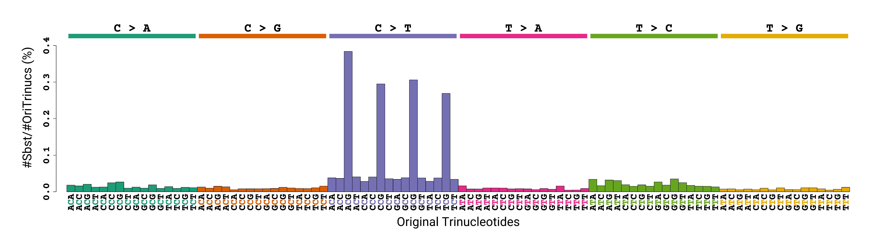

Single-base substitution spectrum for _Amphilophus citrinellus_ (non-coding region):
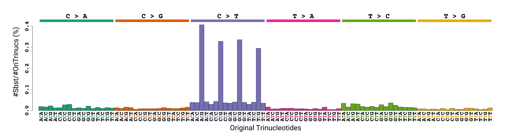

Single-base substitution spectrum for _Amphilophus zaliosus_ (whole genome):
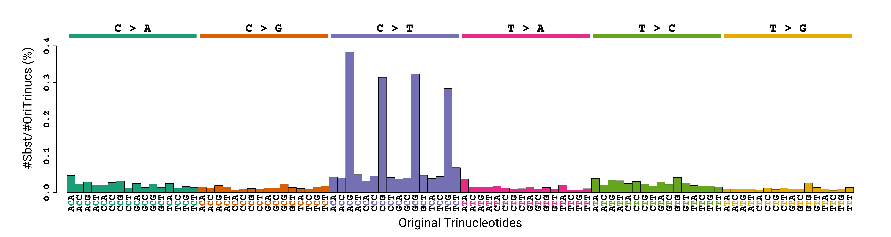

Single-base substitution spectrum for _Amphilophus zaliosus_ (non-coding region):
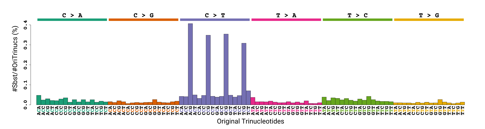

Log-scaled single-base substitution spectrum for _Amphilophus citrinellus_ (whole genome):
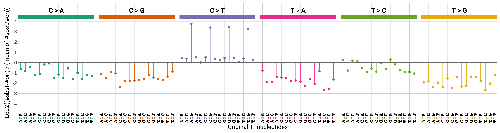

Log-scaled single-base substitution spectrum for _Amphilophus citrinellus_ (non-coding region):
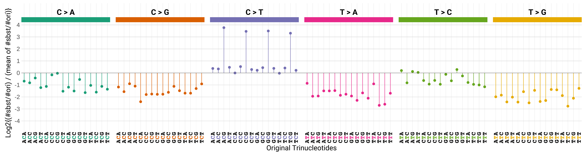

Log-scaled single-base substitution spectrum for _Amphilophus zaliosus_ (whole genome):
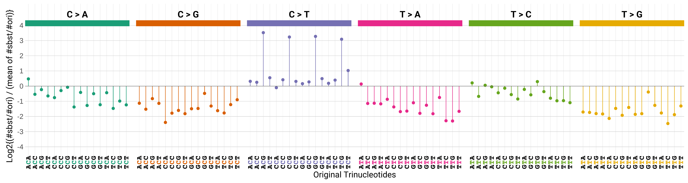

Log-scaled single-base substitution spectrum for _Amphilophus zaliosus_ (non-coding region):
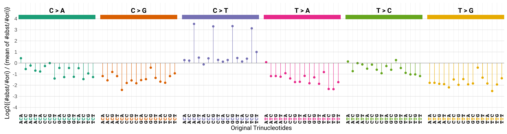

Dinucleotide substitution spectrum for _Amphilophus citrinellus_ (whole genome):
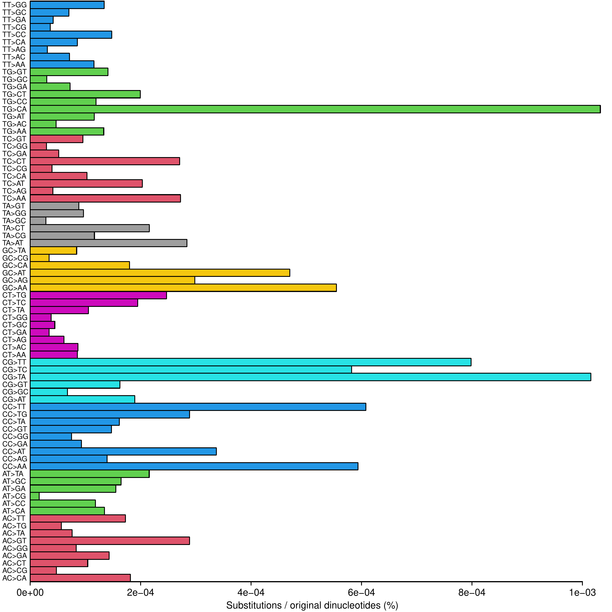

Dinucleotide substitution spectrum for _Amphilophus citrinellus_ (non-coding):
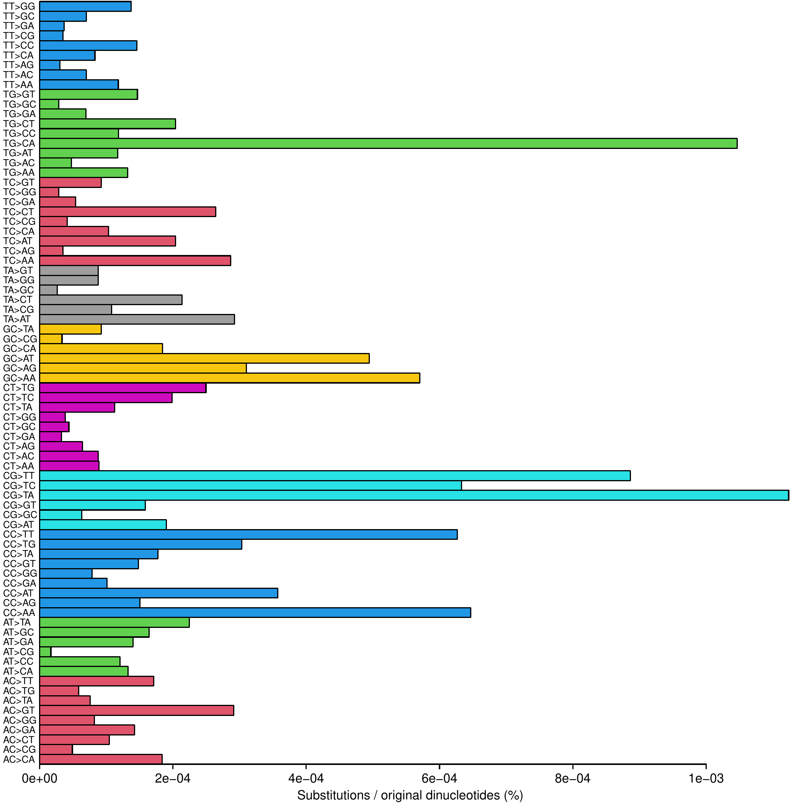

Dinucleotide substitution spectrum for _Amphilophus zaliosus_ (whole genome):
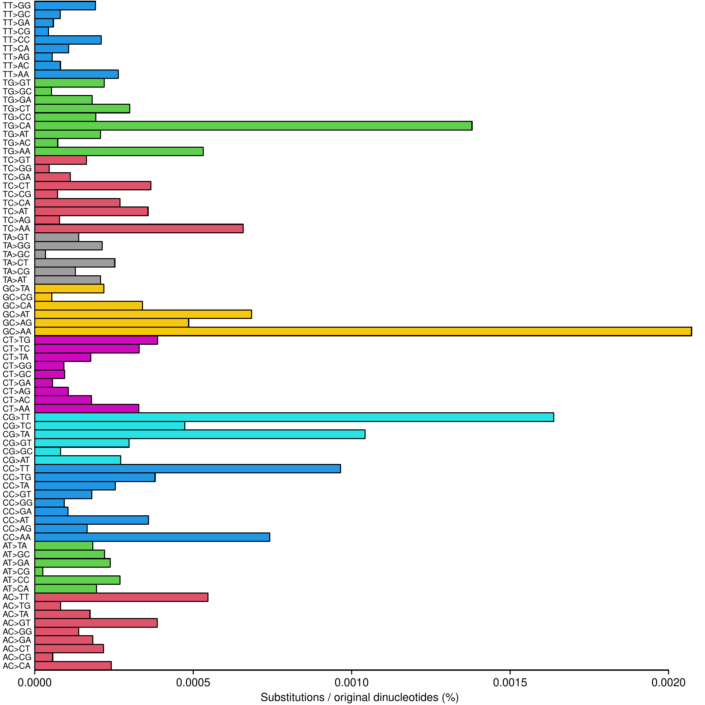

Dinucleotide substitution spectrum for _Amphilophus zaliosus_ (non-coding region):
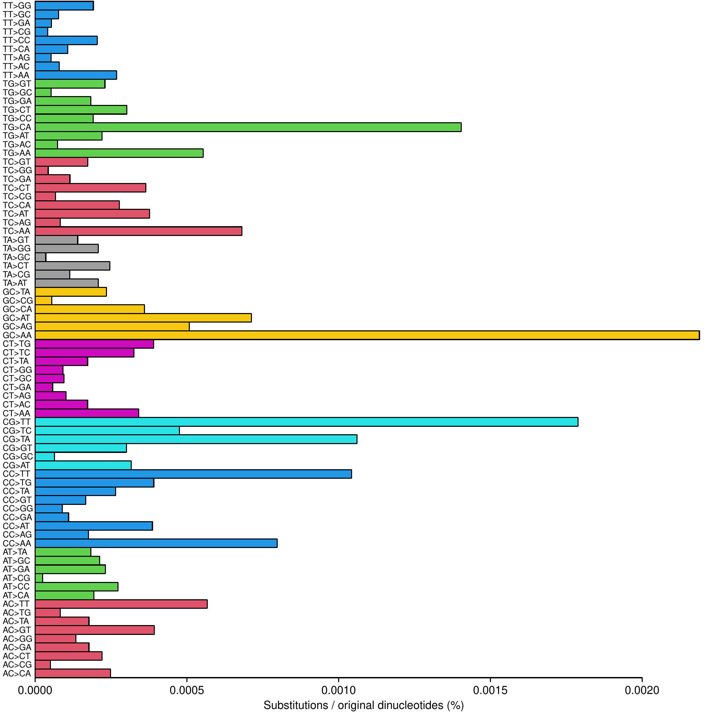

### Spectrum shape clustering and taxonomy

`src/visualize/spectrum_shape.R` generates a dendrogram heatmap, UMAP plots colored
by taxonomy and cluster, and representative 96-channel spectra with median/IQR.
It requires R packages `argparse`, `jsonlite`, `cluster`, `ggplot2`, `uwot`,
`ComplexHeatmap` (Bioconductor), and `circlize`.

```bash
rtk proxy Rscript src/visualize/spectrum_shape.R results/all \
  --taxonomy-levels phylum,class,order --clusters auto --random-state 42
```

The default v2 input mode requires completed manifests with verified artifacts.
Use `--input-mode legacy` for existing result folders without v2 manifests.
In v2 mode, latest completed runs are selected by the shared manifest helper. Noncoding channels are the default; pass
`--tsv-pattern '*.tsv'` for genomic channels. Taxonomy is annotation only and missing
labels become Unknown, without downloads. Each ingroup/run remains a separate sample.
No genus/identity filter is applied.

The log2 ratio matches the existing bar plot: rate divided by the arithmetic mean
of positive rates, then log2. Samples with any zero, invalid, missing, or duplicate
channel are excluded without pseudocounts; inspect `exclusions.csv` and
`taxonomy_counts.csv` for resulting sample loss. The 96 columns retain the six
substitution classes and 16 contexts, without column standardization.

Default clustering uses Euclidean distance and Ward D2; `--method correlation`
uses 1-Pearson correlation and average linkage. Auto selects the best mean
silhouette across 2 through min(10,n-1); change the cap with `--max-clusters` or
choose `--clusters N`. Two samples or all-zero distances default to one cluster.
UMAP is skipped below four samples; its coordinates never determine clusters.
Fixed seed and single-threaded UMAP permit repeatable comparisons within an environment.

Output defaults to `<INPUT_DIR>/spectrum_shape`; use `--output-dir` to select a
fresh empty directory for each run. PDF/PNG figures share scales, accompanied by
CSV matrices, assignments, distances, scores, medoids, summaries, taxonomy
composition, and UMAP coordinates. Settings and package versions are recorded.
The dendrogram represents spectral similarity, not evolutionary ancestry.
Existing PCA and bar-plot scripts are unchanged.

If dependencies are installed in the project-local R library, invoke with
`R_LIBS="$PWD/.venv/spectrum-shape-r-library" Rscript src/visualize/spectrum_shape.R ...`.
On R 4.1, compatible versions include ComplexHeatmap 2.10.0, GlobalOptions 0.1.2,
circlize 0.4.16, and GetoptLong 1.0.5; newer releases can require a newer R version.

Legacy results can be read directly without v2 manifests. For the benchmark runs
linked under `results/all`, choose the region explicitly:

```bash
rtk proxy env R_LIBS="$PWD/.venv/spectrum-shape-r-library" \
  Rscript src/visualize/spectrum_shape.R results/all --input-mode legacy \
  --run-pattern "bench_*" --region whole \
  --output-dir results/all/spectrum_shape_bench_whole
```

Use `--region noncoding` and a different output directory for noncoding spectra.
The default region is noncoding in both modes. The older `--tsv-pattern` option
remains an alias (`*.tsv`: whole; `*_ncds.tsv`: noncoding); conflicting explicit
region and pattern selections are rejected. There is no fallback across regions.
Legacy mode follows trio links once, selects the newest matching run by its
8-digit date, and reads only direct files in `statistics/singlenuc/`. A filename
containing `ncds` means noncoding; `_maflinked` does not influence selection.
Metadata identifies ingroups, including `cds_from_<short_name>` filenames.
Missing and ambiguous TSVs, invalid run dates and tied latest dates are audited.
Local metadata replaces stale absolute paths, missing taxonomy becomes Unknown,
and no downloads occur. `run_decisions.csv` records run selection; sample records
include input and metadata SHA256 hashes. Legacy inputs do not receive v2
completion/provenance verification. Existing v2 validation remains the default.

For a cohort containing legacy runs and newer validated v2 runs, use
`--input-mode mixed --run-pattern "bench_*"`. Matching run names may include
an optional `_HHMMSS` after the date; only the newest timestamp per trio is used.
A selection symlink can point to an unmodified v2 run. Its alias, resolved run
path and logical trio are exported separately. Selected v2 runs must validate and
have complete status; validation failure does not fall back to legacy. Missing
regions never fall back to an older run. Ordered accessions are checked against
older cohort metadata when a v2 run replaces a legacy result.

Spectrum heatmap channel labels use the standard monospace family `mono`.
Annotation colors are allocated jointly across taxonomy levels and clusters, with
known phylum colors reserved. Heatmaps and UMAPs share the mapping exported in
`annotation_colors.csv` (`level`, `label`, `color`, `identifier`); distinct level/label
pairs, including Unknown at different levels, receive distinct RGB colors. Starting
from the joint palette, deterministic replacements and swaps first reduce adjacent
annotation pairs with CIELCh hue gaps below 60 degrees, then maximize the minimum
adjacent and overall CIELab distances. Chroma below 5 is treated as achromatic and
excluded from hue comparisons. Adjacency follows the displayed taxonomy-column order
and observed category pairs; input row order does not affect the mapping. This is a
local optimization, and colors alone do not guarantee every category is distinguishable.
Heatmaps use 8 mm taxonomy strips with 2 mm gaps on a 15-inch canvas. Each contiguous
taxonomy band in clustered row order carries its identifier once at its center, using
black or white text for contrast. Clusters are shown by aligned grey `]` brackets to
the right of the full species labels, with black `Cluster 1` labels rotated 90 degrees
counterclockwise and centered on each displayed run. Labels start at 8 pt and shrink
to at least 6 pt; the canvas grows vertically when a short run needs more room.
The heatmap has no cluster color strip or cluster legend. Sorted phylum/class/order categories use P/C/O identifiers;
clusters retain their numbers with a K prefix, and other ranks use their rank name.
Taxonomy heatmap legends and all UMAP legends show `identifier: category`, without
changing analytical category names or sample IDs. The full palette, including cluster
colors, remains in `annotation_colors.csv` and the cluster UMAP.

### PCA with optional identity thresholds

PCA accepts completed v2 runs and local legacy trio collections such as
`results/all_phdThesis`. Legacy discovery uses immediate trio directories or
symlinks and their latest 8- or 14-digit numeric dated run. Analysis directories
(`pca*`, `archive`, `tmp`, and the `spectrum_shape_bench_*` outputs) and
`bench_*` runs are excluded. Legacy manifests are
normalized in memory; source data and manifests are not modified, and v2
manifest/content validation remains required.

Legacy metadata and taxonomy JSON are resolved under the selected run's local
`metadata/` directory by short name/accession, ignoring stale absolute paths.
Canonical TSVs are selected from `statistics/<short_name>/singlenuc/` or the run
root; multiple matches fail clearly. `--tsv-pattern '*.tsv'` means genomic
single-base tables named `<accession>_<short_name>_<date>.tsv`, excluding
`_maflinked`, dinucleotide and `_ncds` derived tables. The default
`'*_ncds.tsv'` selects only the corresponding noncoding canonical tables.
Identity estimates use the penultimate marker in each pair's local LAST training
file; complete final alignment parameter blocks remain mandatory. Missing or unusable selected sample inputs remain visible in
`pca_trio_filter.csv` with reasons and usable sample counts; missing local
taxonomy is reported without downloading replacements.


`pca_2d.R` produces one logratio and one observed-frequency analysis, using the
usual output names. It no longer generates a separate `_filtered` analysis.
With no identity options, no trios are excluded by identity or genus.

```bash
Rscript src/visualize/pca_2d.R results/giw2026 \
  --ingroup-idt-threshold 90 --outgroup-idt-threshold 80 \
  --min-idt-gap-between-out-in 3 \
  --output-dir results/giw2026/pca_idt90_80_gap3
```

Each optional threshold uses strict `>` (equality fails). `--idt-threshold N`
sets a common absolute identity lower bound; `--ingroup-idt-threshold N` and
`--outgroup-idt-threshold N` override their respective bounds regardless of
argument order. The latter applies to both outgroup–ingroup pairs. Unspecified
conditions stay disabled. Values must be finite numbers in [0,100].
`--min-idt-gap-between-out-in N` requires both ingroup identity minus
outgroup–ingroup identity differences to exceed N percentage points.
When both ingroups share a genus and the outgroup belongs to a different genus,
only the gap condition is waived; absolute identity bounds still apply.
Missing genus information prevents that waiver. Missing or invalid identities
needed by an active condition exclude the trio. Filtering applies to both ingroup
samples together, before reading substitution TSVs.

Every run writes `pca_run_settings.json` with requested/effective thresholds,
disabled conditions, comparison rules, inputs, PCA options, timestamps, counts,
and completion status. `pca_trio_filter.csv` records each trio's identities, gaps,
genera, condition statuses (`disabled`, `waived`, `passed`, `failed`, or
`missing_identity`), inclusion decision, reason, and usable sample count.
These records are also saved if fewer than two usable TSV samples remain and
PCA exits with an error. Existing `_filtered` artifacts are retained with a
warning; use a new output directory to keep results from different runs separate.
